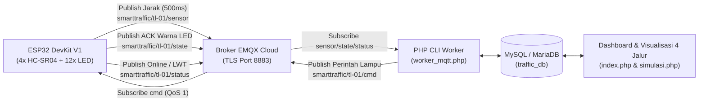

# Smart Adaptive Traffic Light — Sistem Kendali Lampu Lalu Lintas 4 Jalur Berbasis IoT ESP32 & MQTT Cloud

Sistem pemantauan, penghitungan antrean kendaraan, dan pengendalian lampu lalu lintas adaptif 4 jalur (*4-Way Intersection*) secara *real-time* menggunakan **ESP32 DevKit V1**, **4x Sensor Ultrasonik HC-SR04**, **12x Lampu LED**, **Broker EMQX Cloud (MQTT over TLS Port 8883)**, **Worker PHP CLI**, **MySQL/MariaDB**, serta **Web Dashboard & Visualisasi Perempatan 4 Jalur Real-Time**.

---

## 1. Fitur Utama

- **Arsitektur Cloud MQTT Real-Time (TLS 8883):**
  - ESP32 bertugas sebagai perangkat *Edge I/O* (membaca 4 sensor HC-SR04 dengan filter *Median-3* dan mengendalikan 12 LED fisik) serta terhubung ke **EMQX Cloud** menggunakan koneksi terenkripsi TLS.
  - **Worker MQTT PHP (`worker_mqtt.php`)** menjalankan logika adaptif, penghitungan kendaraan, penjadwalan siklus lampu, serta sinkronisasi status dua arah antara ESP32 dan database MySQL.
- **Penghitung Kendaraan Masuk (*Edge Detection + Hysteresis + Deteksi Macet*):**
  - **Mobil Masuk (`< 5.0 cm`):** Setiap kali sensor mendeteksi transisi jarak turun di bawah `5.0 cm` saat jalur sedang menunggu lampu Merah/Kuning, tabungan kendaraan jalur tersebut bertambah **`+1 mobil`** dan kunci deteksi diaktifkan.
  - **Normalisasi Getaran / Hysteresis (`>= 7.0 cm`):** Kunci deteksi baru dilepas ketika jarak kembali menjauh minimal `>= 7.0 cm` (`ambang_cm + 2.0 cm`), sehingga goyangan jarak kecil pada satu mobil yang sama tidak terhitung ganda.
  - **Akumulasi Selama Lampu Merah:** Tabungan jumlah kendaraan **tidak hangus** selama jalur menunggu giliran lampu merah, dan otomatis di-reset kembali ke `0` setelah jalur tersebut selesai menjalani lampu Hijau.
  - **Deteksi Antrean Mengular / Tumpukan Macet (`>= 3.5 detik`):** Jika ada kendaraan yang berhenti tepat di depan sensor (`< 5.0 cm`) secara terus-menerus selama `>= 3.5 detik`, jalur tersebut otomatis dikunci ke status **`Padat` (`15 detik` hijau)**.
- **Adaptasi Durasi Lampu Hijau & Rotasi Giliran Berurutan:**
  - Dalam mode **Otomatis (`AUTO`)**, urutan giliran selalu berputar berurutan secara adil (**`Jalur 1 → Jalur 2 → Jalur 3 → Jalur 4 → Jalur 1`**).
  - Saat giliran suatu jalur tiba, **durasi lampu hijaunya** ditentukan secara adaptif berdasarkan jumlah kendaraan yang mengantre:
    - **`0 – 1` mobil** &rarr; **Sepi** (**`5 detik`** Hijau)
    - **`2 – 3` mobil** &rarr; **Sedang** (**`10 detik`** Hijau)
    - **`>= 4` mobil** *(atau sensor tertutup terus `>= 3.5 dtk`)* &rarr; **Padat** (**`15 detik`** Hijau)
- **Invarian Keselamatan Berlapis (*Safety Guard* di Worker & Firmware ESP32):**
  - **Maksimal 1 Jalur Hijau:** Tidak pernah mengizinkan 2 atau lebih jalur menyala Hijau/Kuning secara bersamaan dalam kondisi apa pun.
  - **Transisi Wajib:** Setiap perpindahan lampu hijau antar-jalur wajib melewati urutan **`Hijau → Kuning (2 detik) → Semua Merah (1 detik) → Jalur Berikutnya Hijau`**.
  - **Mode Fallback Lokal ESP32:** Jika koneksi Wi-Fi/MQTT ke Cloud terputus lebih dari `10 detik`, ESP32 otomatis mengambil alih dengan menjalankan siklus tetap lokal yang aman (`Hijau 5s → Kuning 2s → Semua Merah 1s` berurutan Jalur 1–4) hingga koneksi Cloud pulih.
- **Visualisasi & Simulasi Perempatan 4 Jalur Real-Time (`simulasi.php`):**
  - Menampilkan peta perempatan 4 jalur (standar lajur kiri Indonesia), lampu lalu lintas interaktif, zona deteksi sensor ultrasonik, dan animasi mobil yang bergerak secara **Real-Time mengikuti sensor fisik ESP32 & LED maket**.
  - Mendukung tombol **Hijaukan Manual per Jalur**, tombol **`+ Tambah Mobil` / `- Kurangi Mobil` Real-Time**, serta opsi beralih ke **Mode Simulator Virtual** untuk pengujian skenario tanpa perangkat keras.

---

## 2. Arsitektur Komunikasi & Topik MQTT



| Topik MQTT | Arah | QoS / Retain | Contoh Payload & Fungsi |
| :--- | :--- | :---: | :--- |
| `smarttraffic/tl-01/sensor` | ESP32 &rarr; Worker | QoS 0 | `{"ts":120,"lanes":[{"id":1,"dist_cm":3.8},...]}` — Data jarak 4 sensor tiap 500 ms |
| `smarttraffic/tl-01/cmd` | Worker &rarr; ESP32 | QoS 1, Retain | `{"seq":15,"lanes":[{"id":1,"light":"hijau"},...],"green_s":10}` — Perintah warna lampu |
| `smarttraffic/tl-01/state` | ESP32 &rarr; Worker | QoS 1, Retain | `{"seq":15,"fallback":false,"lanes":[{"id":1,"light":"hijau"},...]}` — Konfirmasi LED fisik |
| `smarttraffic/tl-01/status` | ESP32 &rarr; Worker | QoS 1, Retain | `"online"` atau `"offline"` (*Last Will and Testament*) |

---

## 3. Konfigurasi Pin GPIO ESP32 DevKit V1 (4 Jalur)

| Jalur Persimpangan | HC-SR04 `TRIG` | HC-SR04 `ECHO` | LED **Merah** | LED **Kuning** | LED **Hijau** |
| :--- | :---: | :---: | :---: | :---: | :---: |
| **Jalur 1 (Simpang A - Utara)** | `GPIO 5` *(D5)* | `GPIO 18` *(D18)* | `GPIO 19` *(D19)* | `GPIO 21` *(D21)* | `GPIO 22` *(D22)* |
| **Jalur 2 (Simpang B - Timur)** | `GPIO 13` *(D13)* | `GPIO 12` *(D12)* | `GPIO 23` *(D23)* | `GPIO 4` *(D4)* | `GPIO 2` *(D2)* |
| **Jalur 3 (Simpang C - Selatan)** | `GPIO 14` *(D14)* | `GPIO 34` *(D34)* | `GPIO 25` *(D25)* | `GPIO 26` *(D26)* | `GPIO 27` *(D27)* |
| **Jalur 4 (Simpang D - Barat)** | `GPIO 32` *(D32)* | `GPIO 35` *(D35)* | `GPIO 33` *(D33)* | `GPIO 16` *(RX2)* | `GPIO 17` *(TX2)* |

- **`VCC` keempat sensor HC-SR04** &rarr; Pin **`VIN` (`5V`)** pada ESP32.
- **`GND` keempat sensor + katoda ke-12 LED** &rarr; Pin **`GND`** bersama pada ESP32.
- **Catatan:** Pin `GPIO 34` dan `GPIO 35` merupakan pin khusus *Input-Only* pada ESP32 sehingga digunakan untuk pin **`ECHO`** Jalur 3 dan Jalur 4.

---

## 4. Struktur Direktori Proyek

```text
Smart-Traffic/
├── assets/
│   ├── css/
│   │   ├── style.css                  # Styling utama Dashboard Web
│   │   └── simulasi.css               # Styling kanvas perempatan 4 jalur & animasi mobil
│   └── js/
│       ├── main.js                    # Interaksi pencarian, filter, & auto-refresh Dashboard
│       └── simulasi.js                # Mesin visualisasi real-time ESP32 & simulator 4 jalur
├── esp32/
│   └── smart_traffic_esp32/
│       ├── smart_traffic_esp32.ino    # Firmware utama ESP32 (4 sensor + 12 LED + MQTT TLS + Fallback)
│       ├── secrets.example.h          # Template konfigurasi Wi-Fi & kredensial MQTT ESP32
│       └── secrets.h                  # Kredensial aktif ESP32 (diabaikan oleh .gitignore)
├── includes/
│   ├── MqttClient.php                 # Klien MQTT 3.1.1 native PHP (mendukung TLS 8883 tanpa ekstensi)
│   ├── db_init.php                    # Inisialisasi & migrasi otomatis 5 tabel database
│   ├── header.php                     # Navigasi utama & indikator status koneksi ESP32
│   ├── hero.php                       # Ringkasan hero & pratinjau cepat 4 jalur
│   ├── simpang_grid.php               # Kartu monitoring 4 jalur & kontrol prioritas manual
│   ├── log_table.php                  # Tabel riwayat siklus lampu & log kejadian MQTT
│   └── footer.php                     # Footer halaman & pemuat skrip
├── api_live_state.php                 # Endpoint JSON real-time (polling 250ms & tambah/kurangi mobil)
├── api_esp32.php                      # [Deprecated] Endpoint HTTP lama (dipertahankan untuk kompatibilitas)
├── config.example.php                 # Template konfigurasi Database & EMQX Cloud
├── config.php                         # Konfigurasi aktif server PHP (diabaikan oleh .gitignore)
├── index.php                          # Halaman Dashboard Monitoring & Kontrol Utama
├── simulasi.php                       # Halaman Visualisasi & Simulasi Perempatan 4 Jalur Real-Time
├── update_manual.php                  # Handler pengubah mode AUTO / MANUAL Prioritas Jalur
├── worker_mqtt.php                    # Worker CLI PHP (penghitung kendaraan, siklus adaptif, & MQTT)
├── simulasi_lokal.php                 # Simulator CLI lokal untuk demo dashboard tanpa hardware ESP32
├── pengujian_otomatis.php             # Suite pengujian otomatis (sensor, hysteresis, invarian, DB, MQTT)
├── jalankan_worker.bat                # Shortcut Windows untuk menjalankan worker_mqtt.php
├── jalankan_simulasi.bat              # Shortcut Windows untuk menjalankan simulasi_lokal.php
└── traffic_db.sql                     # Skema lengkap 5 tabel database MySQL (traffic_db)
```

---

## 5. Urutan Cara Menjalankan Proyek

### Langkah 1 — Persiapan Konfigurasi Awal *(Cukup Sekali)*
1. Salin `config.example.php` menjadi `config.php`, lalu sesuaikan port MySQL (default XAMPP: `3307` atau `3306`) serta kredensial broker EMQX Cloud Anda.
2. Untuk firmware ESP32, salin `esp32/smart_traffic_esp32/secrets.example.h` menjadi `secrets.h`, isi `WIFI_SSID`, `WIFI_PASSWORD`, dan kredensial EMQX Cloud, lalu *upload* `smart_traffic_esp32.ino` melalui Arduino IDE (pustaka yang dibutuhkan: **PubSubClient** dan **ArduinoJson**).

### Langkah 2 — Nyalakan XAMPP (Apache & MySQL)
1. Buka **XAMPP Control Panel**, lalu klik **Start** pada **Apache** dan **MySQL**.
2. Buat database `traffic_db` di phpMyAdmin (atau impor `traffic_db.sql`). Saat pertama kali diakses, `includes/db_init.php` juga akan memastikan kelima tabel (`status_persimpangan`, `log_lalu_lintas`, `config`, `sensor_log`, `event_log`) terbentuk otomatis.

### Langkah 3 — Nyalakan Hotspot Wi-Fi & Perangkat ESP32
1. Nyalakan Hotspot/Wi-Fi sesuai SSID di `secrets.h`.
2. Hubungkan ESP32 ke daya USB. Sebelum Worker dinyalakan, ESP32 akan menjaga maket tetap berjalan aman menggunakan siklus Fallback Lokal.

### Langkah 4 — Jalankan Worker MQTT PHP
Klik dua kali file **`jalankan_worker.bat`** (atau jalankan di terminal):
```powershell
C:\xampp\php\php.exe Smart-Traffic\worker_mqtt.php
```
> Biarkan jendela terminal Worker tetap terbuka selama alat beroperasi. Begitu Worker terhubung ke EMQX Cloud, maket ESP32 otomatis mengikuti kendali adaptif Worker.

### Langkah 5 — Buka Dashboard & Visualisasi 4 Jalur di Browser
- **Dashboard Utama:** `http://localhost/Smart-Traffic/Smart-Traffic/` *(atau `http://localhost/Smart-Traffic/` sesuai posisi folder di `htdocs`)*
- **Visualisasi & Simulasi 4 Jalur Real-Time:** Klik menu **"Simulasi 4 Jalur"** di navigasi atas (`simulasi.php`).

---

## 6. Pengujian Otomatis

Untuk memverifikasi filter sensor *Median-3*, penghitung kendaraan *Edge Detection + Hysteresis*, invarian keselamatan transisi 10 siklus, keamanan *Prepared Statements* MySQL, dan koneksi TLS EMQX Cloud, jalankan:

```powershell
C:\xampp\php\php.exe Smart-Traffic\pengujian_otomatis.php
```
